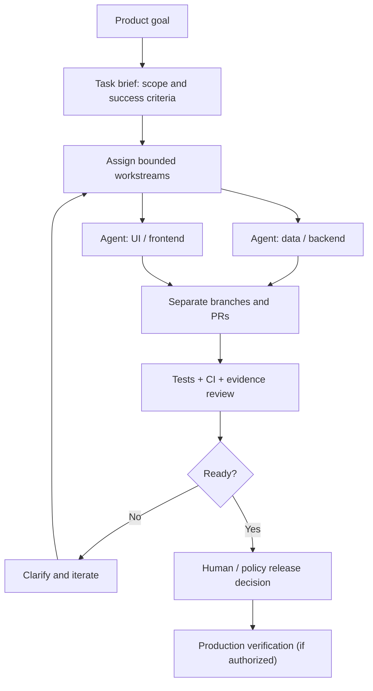

# AI agent operations — a practical playbook

[Portfolio](README.md) · [Ecosystem](ECOSYSTEM.md) · [Case studies](CASE_STUDIES.md)

This page explains **how I work with coding agents**, not a claim that ChatGPT and Codex have an unrestricted native two-way messaging channel.

## Working model



This is an **operational pattern**, not a claim that all steps are automated or that agents can talk to each other autonomously in ordinary ChatGPT threads. Some coordination still relies on tools, GitHub or manual routing.

## Responsibilities

| Role | Scope | What it must not assume |
| --- | --- | --- |
| Product owner / coordinator (me) | Choose priorities, express requirements, manage boundaries and evaluate evidence | Agent output is not proof of correctness |
| Specialized coding agent | Deliver a limited change with tests, diff and status | Authorization to edit one area does not authorize unrelated changes |
| CI / QA | Re-run checks, compare expected behavior, document failures | Green CI alone does not prove user impact or a successful deployment |
| Release decision maker | Verify production conditions, scope and rollback | A merged PR is not automatically deployed |

## Example of an agent-ready task brief

```text
Project: [specific project]
Business goal: [who benefits and why]
Scope: [files/features permitted]
Out of scope: [do not touch]
Inputs: [approved source and current baseline]
Acceptance criteria:
  - [observable behavior]
  - [tests and failure cases]
  - [mobile / desktop checks if relevant]
Evidence required:
  - PR link + exact SHA
  - CI run status and test summary
  - limitations / blockers / known risks
Release policy: [draft only / review required / authorized deploy path]
Rollback: [pre-approved reversible procedure]
```

## Verification ladder

1. **Proposed:** a task, issue or idea exists.
2. **Implemented:** a diff or commit exists; still unverified.
3. **Tested:** specified checks pass for a named SHA/environment.
4. **Reviewed:** scope, tests, risks and outstanding issues assessed.
5. **Merged:** changes entered the target branch.
6. **Deployed:** production release completed through an authorized path.
7. **Observed:** live behavior verified with appropriate evidence.
8. **Impact measured:** business or user outcomes established over an explicit period.

Never collapse these into a single word like “done.” A prototype, test build, staging release, indexable site and profitable product are different outcomes.

## A case in practice: split data and design workstreams

On a Laravel product, work was divided between **DATA** (source data, import reliability and validation) and **DESIGN** (Blade/UI, mobile experience and visual checks). A coordination function tracked GitHub PRs and CI and protected workstream boundaries.

Key rules included:
- One agent does not overwrite another agent’s worktree.
- A source/import change is not silently mixed with design changes.
- Data writes and production releases use stricter safeguards than a reversible documentation or UI branch.
- Results need exact source references, not a verbal “all passed.”
- The owner keeps the authority to stop, change priority or reject a release.

This operating model can be applied to a small portfolio without pretending to have a fully autonomous orchestration platform.

## Failure modes I watch for

| Failure | Countermeasure |
| --- | --- |
| Context lost between chats and agents | GitHub issue briefs, current state documents, explicit links and task IDs |
| Agent declares success without test evidence | Demand CI SHA, test commands, results and failure notes |
| Multiple agents edit the same area | Worktree separation, ownership boundaries and integration checks |
| Staging presented as production | Name the environment and release state every time |
| AI-generated information lacks a source | Provenance, verification gates and editorial distinction |
| API or inference expense grows unchecked | Budgets, fake/test modes, opt-in paid operations |
| Research keeps running without signal | Predefined stop rules, baselines and archived negative findings |

## Skills and limits

**Demonstrated coordination:** task decomposition, multi-agent routing, GitHub workflow control, product/QA oversight and incident triage.

**Still developing:** independent Python implementation, code debugging, backend/API design and quantitative reliability evaluation.

See [case studies](CASE_STUDIES.md) for examples and [evidence & privacy policy](EVIDENCE_AND_PRIVACY.md) for how I report outcomes.
