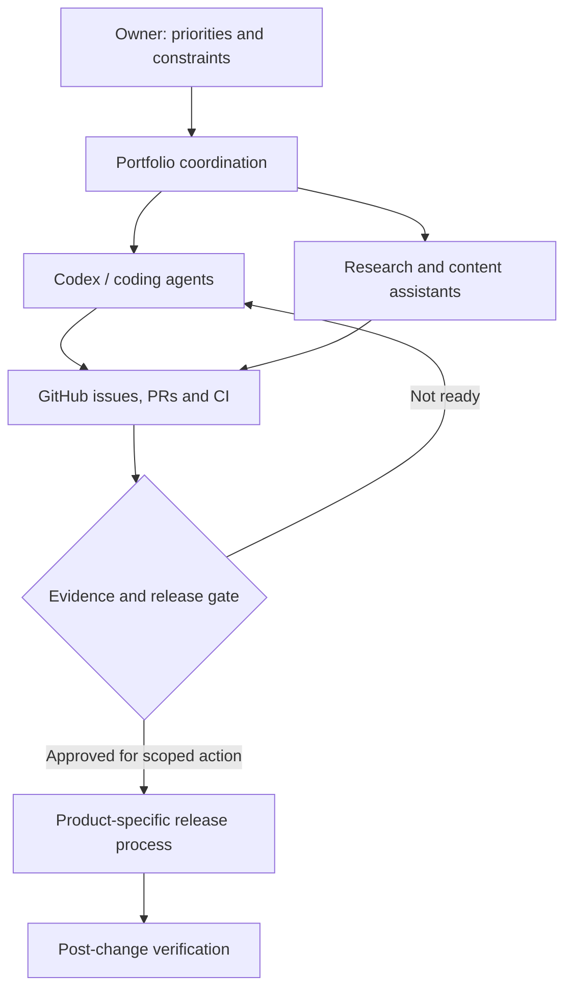

# Project ecosystem | Карта экосистемы

[Portfolio](README.md) · [Русская версия](README.ru.md) · [Case studies](CASE_STUDIES.md) · [Agent operations](AGENT_OPERATIONS.md)

> **Scope:** the earlier portfolio audit reviewed 26 repositories. A fresh connected GitHub listing on **29 October 2026** shows **36 accessible repositories**, including recently restored research archives. The added repositories have **not yet been individually validated**; this document covers only case-supported work. **36 repositories does not mean 36 deployed products, independently coded applications or profitable businesses.**
>
> Private repository details are deliberately summarized. Public websites are not proof that all features, claims, or integrations are currently live.

My role across the portfolio is generally **product owner / AI-agent coordinator**: problem definition, planning, task delegation, quality and release decisions. I use coding agents for substantial portions of implementation; I do not claim exclusive authorship of agent-generated code.

## 1 · Web products, SEO and deployment

| Project / direction | What it demonstrates | Evidence / maturity |
| --- | --- | --- |
| **PolisHelp** — insurance information and comparisons | Production incident diagnosis, mobile UX, SEO, Nginx/HTTP/2, safe release verification | Live product; [public, bounded incident write-up](https://github.com/ruslanudintsev-ai/ios-cellular-nginx-http2-fix) |
| **1CreditOnline** — financial information platform | Coordination of **two specialized Codex agents** on data and design workstreams, GitHub CI, safeguards for updates | Production product; orchestration details in private repository |
| **OSAGO catalogue recovery** | Rebuilding and validating a large Django/static route generator; sitemap and canonical checks | Recovery QA evidence; **not** a claim that all generated pages are deployed/indexed |
| **BFA catalogue experiment** | Content templates, price provenance constraints, local/staging vs public separation | Experiment / release preparation; staging is not a public SEO launch |
| **KursoPilot** — education-course comparisons | AI-agent coordination, Astro/TypeScript catalogue, source attribution, CI and editorial release gates | **Operator-reported public v1 on 28 Oct 2026:** 10 URLs eligible for indexing, 29 noindex and 16/16 live-smoke checks; independent site check and indexing not established · [Case 10](CASE_STUDIES.md#case-10--kursopilot-agent-assisted-public-release-of-a-course-catalogue) |
| **Historical pet-food content websites** | Owner-reported automated population of niche content sites; archived articles from 2024 and later full-autopilot design work | Discontinued / historical; original automation mechanism and coverage not independently verified |
| **Related information sites** | Multi-site CI discipline, SEO research, content maintenance, and release coordination | Mixed maturity; individual results require separate evidence |
| **Multilingual content catalogue** | Route parity, localization, media inventories and static publishing workflows | Project-specific production/preview scopes; no traffic or revenue claim here |

## 2 · AI-powered application experiments

| Direction | Agent and product work | Maturity |
| --- | --- | --- |
| **Personalized music-gift Telegram bot** | Story → structured plan → validation → music adapter → artifact → feedback. Explicit paid-call guardrails and deterministic fake-mode tests | Fake-mode end-to-end product acceptance recorded; paid music generation **not** accepted as live |
| **AI Telegram reply assistant** | Structured generation, style choices, retry/cost limits, payment-state safety and QA | MVP development; public commercial launch not claimed |
| **EVE Online companion tooling** | Data/API integration concepts and a game-related analytics assistant | Experimental/private; not described as a production SaaS |
| **AI-agent dispatch** | Workstream separation, task queues, PR/CI monitoring and documented intervention points | Operating process used in real GitHub projects |

## 3 · Research, modelling and experiments

| Direction | What was learned | Maturity |
| --- | --- | --- |
| **LLM-assisted trading research** | Evidence-based evaluation, failure forensics, deterministic signals and stopping work when evidence is insufficient | Archived/frozen; **no demonstrated trading edge or profitability claim** |
| **Reinforcement-learning exercises** | DQN / Double DQN / PER / Dueling / NoisyNet experiments; baseline comparison | [Public educational repository](https://github.com/ruslanudintsev-ai/dqn-beginner-rainbow-trading), not a validated trading system |
| **FinRL / Mamba research** | Reproducibility plans, dataset constraints, cost controls | Paused; no proven production model |
| **Other small prototypes** | Practical exploration of game systems, web development and local AI | Different states; not all are actively developed |

## 4 · Public artifacts you can inspect

1. [Nginx / iPhone mobile data incident — multilingual technical report](https://github.com/ruslanudintsev-ai/ios-cellular-nginx-http2-fix)
2. [Reinforcement-learning educational experiments](https://github.com/ruslanudintsev-ai/dqn-beginner-rainbow-trading)
3. [OpenAI Codex product feedback — specific hands-on Grok Bot / Cursor example](https://github.com/openai/codex/issues/40142#issuecomment-6492738160)
4. [A public web prototype repository](https://github.com/ruslanudintsev-ai/opalubka)

The strongest operations evidence for some cases remains private by design. If an interviewer requests proof, a **redacted walkthrough** of task scope, PR metadata, tests and release decisions can be arranged without exposing passwords, customers or infrastructure.

## How these projects fit together

**Boundaries:** a portfolio map is not permission to run, deploy or change any of these projects. Each project has its own rules and source of truth. Private repository access is not implied by links or descriptions.

See [the agent coordination playbook](AGENT_OPERATIONS.md) and [the evidence/privacy rules](EVIDENCE_AND_PRIVACY.md).
