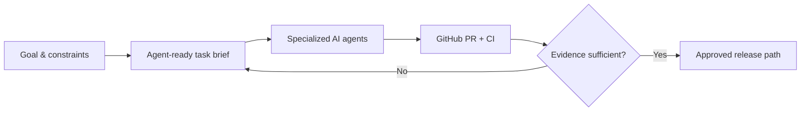

# Ruslan Udintsev / Руслан Удинцев

**AI Agent Operator · AI-assisted Development Coordination · Product QA**

**100% remote only** · Open to suitable paid roles and scoped projects

I turn a product goal into a **testable AI-assisted development workflow**: clear tasks for Codex/Gemini and other coding agents, GitHub PRs, CI checks and a human decision about release readiness.

**[Recruiter brief](HIRE_ME.md)** · **[Public evidence in 60 seconds](docs/EVIDENCE_INDEX.md)** · **[Русское портфолио](README.ru.md)** · **[11 case studies](CASE_STUDIES.md)**

### Three examples to inspect

| Work sample | Practical role and evidence |
| --- | --- |
| **[KursoPilot](https://kursopilot.ru/)** | Product goals, AI-agent coordination and QA for an education catalogue. First limited release **reported** on 28 Oct 2026; [scope and verification limits](CASE_STUDIES.md#case-10--kursopilot-agent-assisted-public-release-of-a-course-catalogue). |
| **[iPhone / Nginx incident](https://github.com/ruslanudintsev-ai/ios-cellular-nginx-http2-fix)** | Real-device investigation and verification after an HTTP/2 configuration change; root cause remains unproven. |
| **[Codex + Grok + Cursor via GitHub](docs/CASE_MULTI_AGENT_GITHUB.md)** | Coordinated task boundaries, PR review, exact-commit CI and human release gates; two diagrams, no claim of fully autonomous agent chat. |

**What I personally do:** scope tasks, coordinate agents, run practical checks, review results and make product/acceptance decisions. **AI-assisted implementation is credited to the tools;** I do not claim independent senior Python/backend expertise.

[**Runnable offline PR/CI triage demo**](examples/pr-evidence-gate/README.md) (Python stdlib, synthetic data, 13 unit tests; not a production release gate)

[Skills by evidence](SKILLS.md) · [How I work](AGENT_OPERATIONS.md) · [Full project map](ECOSYSTEM.md) · [Русская страница для работодателей](HIRE_ME.ru.md)

---

## My work at a glance

| Portfolio | Agent operations | Public proof |
| --- | --- | --- |
| Maintained products, experiments, private work and archives; newly restored repositories are under review | Parallel Codex workstreams, scoped tasks, PR/CI review and release gates | [iPhone/Nginx field report](https://github.com/ruslanudintsev-ai/ios-cellular-nginx-http2-fix) · [OpenAI Codex product feedback](https://github.com/openai/codex/issues/40142#issuecomment-6492738160) |

*A prior reviewed inventory covered 26 repositories; the connected account now lists 36, including restored research repositories that are not yet individually verified (29 October 2026). Repository count is not proof of launched products, personally written code, or business results.*

## Skill system: what I can actually do

| Hands-on operational skills | AI-assisted delivery experience | Still learning |
| :---: | :---: | :---: |
| **15** | **9** | **6** |

**Strongest focus:** agent task design, multi-agent coordination, GitHub PR/CI oversight, product quality and release decisions. **Agent-assisted experience:** LLM APIs, structured model outputs, Telegram bots, backend and deployment tooling. **Not yet claiming independent expertise:** Python backend engineering, RAG, LangChain, LangGraph, ATS integration or ML engineering.

[**Browse all 30 skills with levels, scope and evidence →**](SKILLS.md) · [По-русски](SKILLS.ru.md)

## Selected cases

| Case | Problem I helped solve | Evidence and limits |
| --- | --- | --- |
| **Multi-agent Laravel operations** | Split one web product into DATA / DESIGN Codex workstreams with task boundaries and CI checks | Internal project workflows; no claim of unrestricted native agent-to-agent chat |
| **GitHub-mediated Codex / Grok / Cursor coordination** | Keep AI-agent work scoped across PR comments, CI and human release gates | [Sanitized case and two diagrams](docs/CASE_MULTI_AGENT_GITHUB.md); private evidence and no claim of direct AI chat |
| **Production incident** | Safari/iPhone mobile-network HTTPS rendering issue, investigated with scoped Nginx experiments | [Public technical case study](https://github.com/ruslanudintsev-ai/ios-cellular-nginx-http2-fix); root cause remains uncertain |
| **Django catalogue recovery** | Coordinate reproducible regeneration and QA for a large static-route catalogue | **217,184** rendered test routes and **216,076** sitemap URLs in a *recovery artifact*, **not** proof of deployment/indexation |
| **AI Telegram product** | Design strict AI-call validation, fake-mode testing, cost and privacy safeguards | End-to-end acceptance in **fake mode**; no claim of paid music launch |
| **KursoPilot — AI-operated web product** | Coordinated catalogue, editorial content, source quality gates, CI and first public release | 28 Oct 2026: operator reports 10 indexable-eligible URLs / 29 noindex, smoke 16/16; indexing and independent live check unverified · [Case 10](CASE_STUDIES.md#case-10--kursopilot-agent-assisted-public-release-of-a-course-catalogue) |
| **Research integrity** | Preserve negative evidence and stop AI/ML experiments without sufficient signal | Paused LLM trading research; [public educational DQN experiments](https://github.com/ruslanudintsev-ai/dqn-beginner-rainbow-trading) |
| **Historical content automation** | Operated earlier pet-food websites with owner-reported automated content filling | Historical 2024 publications; original pipeline source/coverage not independently verified |

[**Read all 11 detailed cases →**](CASE_STUDIES.md)

## My operating model

I prefer measurable acceptance criteria, separate worktrees for independent agents, a documented source of truth, and visible failure reports. **A generated change, a passing test, a merged PR and a production release are different states.**

[**See the agent coordination playbook →**](AGENT_OPERATIONS.md)

## Ecosystem of projects

I oversee work spanning **insurance and finance information sites, education-course discovery, SEO/content systems, Telegram AI experiments, game companion tools, and AI/ML research**. Projects vary in maturity, and I label pilots, production systems and paused experiments separately.

[**Explore the ecosystem →**](ECOSYSTEM.md)

## Tools I use vs. what I'm learning

**Use in real workflows:** ChatGPT, Codex, Gemini, GitHub Issues/PRs, GitHub Actions, QA reports, browser testing, SEO diagnostics and product documentation.

**Hands-on exposure through projects:** Laravel, Django, Astro/TypeScript, Nginx, Docker, Cloudflare, API-based products.

**Actively developing:** independent Python implementation, code review/debugging, API integration and systematic evaluation of agent reliability.

I do not equate using AI to generate code with independently mastering every part of that code.

## Let's collaborate

I can help scope and operate an AI-assisted development workflow: split a backlog into clear agent tasks, review execution evidence, identify blockers and prepare a release-readiness report.

**Work with me:** [Scope, role fit and evidence for hiring](HIRE_ME.md) · [Portfolio repository](https://github.com/ruslanudintsev-ai/RuslanUdintsev-AI)

[Evidence & privacy policy](EVIDENCE_AND_PRIVACY.md) · [Русская версия портфолио](README.ru.md)

*Public technical artifacts are linked directly; sensitive production information and private source code are not disclosed.*
