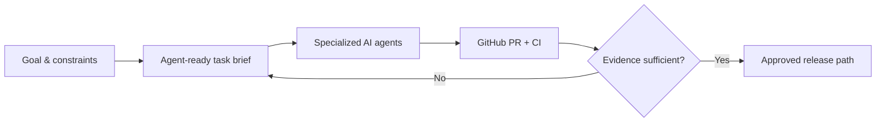

# Ruslan Udintsev

### AI Agent Operations · AI-assisted Development Coordination · Product & QA

I turn business and product goals into **well-scoped tasks for AI coding agents**, coordinate parallel workstreams, and verify the outcome through GitHub, tests and release evidence.

I am a **hands-on product owner / AI-agent operator**, not a self-described senior developer: I use Codex, ChatGPT, Gemini and other tools for implementation while taking responsibility for requirements, priorities, boundaries and acceptance.

**Interested in:** AI Agent Operator · Junior AI Automation Specialist · AI Development Coordinator · AI-assisted QA · remote/project opportunities.

**[Русский](README.ru.md)** · **[Project ecosystem](ECOSYSTEM.md)** · **[8 case studies](CASE_STUDIES.md)** · **[How I manage agents](AGENT_OPERATIONS.md)**

---

## My work at a glance

| Portfolio | Agent operations | Public proof |
| --- | --- | --- |
| 26 GitHub repositories reviewed (including private, experimental and archived work) | Parallel Codex workstreams, scoped tasks, PR/CI review and release gates | [iPhone/Nginx field report](https://github.com/ruslanudintsev-ai/ios-cellular-nginx-http2-fix) · [OpenAI Codex product feedback](https://github.com/openai/codex/issues/40142#issuecomment-6492738160) |

*Repository count does not equal launched products, personal code authorship or business results. Snapshot: 29 October 2026.*

## Selected cases

| Case | Problem I helped solve | Evidence and limits |
| --- | --- | --- |
| **Multi-agent Laravel operations** | Split one web product into DATA / DESIGN Codex workstreams with task boundaries and CI checks | Internal project workflows; no claim of unrestricted native agent-to-agent chat |
| **Production incident** | Safari/iPhone mobile-network HTTPS rendering issue, investigated with scoped Nginx experiments | [Public technical case study](https://github.com/ruslanudintsev-ai/ios-cellular-nginx-http2-fix); root cause remains uncertain |
| **Django catalogue recovery** | Coordinate reproducible regeneration and QA for a large static-route catalogue | **217,184** rendered test routes and **216,076** sitemap URLs in a *recovery artifact*, **not** proof of deployment/indexation |
| **AI Telegram product** | Design strict AI-call validation, fake-mode testing, cost and privacy safeguards | End-to-end acceptance in **fake mode**; no claim of paid music launch |
| **Source-aware content** | Separate verified facts, draft records and publication gates | KursoPilot and related experiments; no unsupported publication claims |
| **Research integrity** | Preserve negative evidence and stop AI/ML experiments without sufficient signal | Paused LLM trading research; [public educational DQN experiments](https://github.com/ruslanudintsev-ai/dqn-beginner-rainbow-trading) |

[**Read all eight detailed cases →**](CASE_STUDIES.md)

## My operating model

I prefer measurable acceptance criteria, separate worktrees for independent agents, a documented source of truth, and visible failure reports. **A generated change, a passing test, a merged PR and a production release are different states.**

[**See the agent coordination playbook →**](AGENT_OPERATIONS.md)

## Ecosystem of projects

I oversee work spanning **insurance and finance information sites, education-course discovery, SEO/content systems, Telegram AI experiments, game companion tools, and AI/ML research**. Projects vary in maturity, and I label pilots, production systems and paused experiments separately.

[**Explore the ecosystem →**](ECOSYSTEM.md)

## Tools I use vs. what I'm learning

**Use in real workflows:** ChatGPT, Codex, Gemini, GitHub Issues/PRs, GitHub Actions, QA reports, browser testing, SEO diagnostics and product documentation.

**Hands-on exposure through projects:** Laravel, Django, Astro/TypeScript, Nginx, Docker, Cloudflare, API-based products.

**Actively developing:** independent Python implementation, code review/debugging, API integration and systematic evaluation of agent reliability.

I do not equate using AI to generate code with independently mastering every part of that code.

## Let's collaborate

I can help scope and operate an AI-assisted development workflow: split a backlog into clear agent tasks, review execution evidence, identify blockers and prepare a release-readiness report.

**Contact:** [GitHub profile](https://github.com/ruslanudintsev-ai) · [Portfolio repository](https://github.com/ruslanudintsev-ai/RuslanUdintsev-AI)

[Evidence & privacy policy](EVIDENCE_AND_PRIVACY.md) · [Русская версия портфолио](README.ru.md)

*Public technical artifacts are linked directly; sensitive production information and private source code are not disclosed.*
