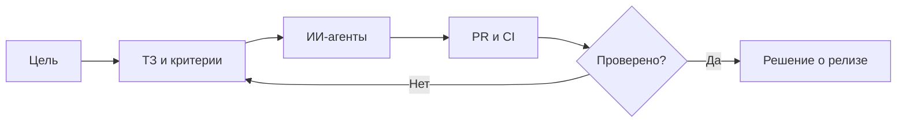

# Руслан Удинцев

### Управление ИИ-агентами · Координация AI-разработки · Контроль качества

Я превращаю продуктовые задачи в **понятные поручения для ИИ-агентов**, организую параллельную работу и проверяю результат по GitHub, тестам и релизным отчётам.

Моя специализация — **владелец продукта и оператор ИИ-агентов**. Существенную часть программной реализации выполняют Codex, Gemini и другие инструменты. Я отвечаю за приоритеты, требования, контроль качества, ограничения и решения по выпуску, но не выдаю весь код за написанный вручную.

**Рассматриваю работу:** AI Agent Operator · Junior AI Automation Specialist · координатор AI-разработки · AI-assisted QA. Удалённо / проектно.

**[English](README.md)** · **[Экосистема](ECOSYSTEM.ru.md)** · **[8 кейсов](CASE_STUDIES.md)** · **[Мой процесс управления агентами](AGENT_OPERATIONS.md)**

---

## Масштаб и подтверждения

| Портфель | Координация | Публичные доказательства |
| --- | --- | --- |
| 26 репозиториев GitHub: рабочие, приватные, экспериментальные и архивные | Параллельные Codex, распределение задач, контроль PR/CI и релизов | [Кейс iPhone/Nginx](https://github.com/ruslanudintsev-ai/ios-cellular-nginx-http2-fix/blob/main/README.ru.md) · [Предложение в OpenAI](https://github.com/openai/codex/issues/40142#issuecomment-6492738160) |

*26 репозиториев не означают 26 запущенных продуктов, 26 самостоятельно написанных приложений или подтверждённую выручку. Срез: 29.10.2026.*

## Основные кейсы

| Направление | Задача | Что реально подтверждено |
| --- | --- | --- |
| **1CreditOnline** | Два Codex: DATA и DESIGN; разделение ответственности и CI | Внутренние задачи, PR и процессы контроля |
| **PolisHelp / iPhone** | Техническая диагностика HTTPS через мобильную сеть | [Публичный отчёт](https://github.com/ruslanudintsev-ai/ios-cellular-nginx-http2-fix/blob/main/README.ru.md); первопричина не доказана |
| **Восстановление Django-каталога** | Проверить воспроизводимость маршрутов и sitemap | 217 184 HTML-маршрута в **тестовой** сборке; не показатель индексации |
| **AI Telegram-продукт** | Ограничить вызовы платных моделей и проверить доставку, повторы, приватность | End-to-end проверки в **fake-mode**, не коммерческий запуск |
| **KursoPilot** | Источники данных, шаблоны, критерии публикации | Разработка; публичная публикация не заявлена |
| **AI/ML-эксперименты** | Проверять гипотезы, фиксировать неудачи, останавливать работы без результата | Замороженное исследование; [учебный DQN](https://github.com/ruslanudintsev-ai/dqn-beginner-rainbow-trading) |

[**Все 8 кейсов подробно →**](CASE_STUDIES.md)

## Как я работаю

У каждого исполнителя — собственная зона ответственности. Ошибки не прячем; запрос к агенту, рабочая ветка, зелёные тесты, слияние и production — **разные состояния**.

[**Подробно о координации агентов →**](AGENT_OPERATIONS.md)

## Наша экосистема

В портфеле — страховые и финансовые веб-продукты, образовательные каталоги, SEO-автоматизация, AI Telegram-боты, игровые инструменты и исследования моделей. Не каждый проект запущен или активен; реальные статусы указаны отдельно.

[**Карта экосистемы на русском →**](ECOSYSTEM.ru.md)

## Инструменты и развитие

**Работаю регулярно:** ChatGPT, Codex, Gemini, GitHub, Issues/PR, GitHub Actions, QA, браузерные проверки, SEO-диагностика, документация.

**Опыт взаимодействия с проектами на:** Laravel, Django, Astro/TypeScript, Nginx, Docker, Cloudflare и API.

**Осваиваю глубже:** самостоятельный Python, отладку и чтение кода, API, оценку надёжности ИИ-агентов.

## Сотрудничество

Готов взять практическую задачу: организовать работу AI-агентов над небольшим GitHub-проектом, разбить её на этапы, проверить PR/CI и подготовить отчёт о готовности изменений.

**Связаться:** [GitHub](https://github.com/ruslanudintsev-ai) · [Репозиторий портфолио](https://github.com/ruslanudintsev-ai/RuslanUdintsev-AI)

[Правила доказательности и приватности](EVIDENCE_AND_PRIVACY.md) · [English](README.md)

*Закрытые исходники, серверные доступы и личные данные в портфолио не публикуются.*
