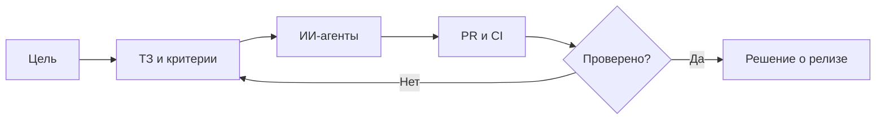

# Руслан Удинцев

### Управление ИИ-агентами · Координация AI-разработки · Контроль качества

Я превращаю продуктовые задачи в **понятные поручения для ИИ-агентов**, организую параллельную работу и проверяю результат по GitHub, тестам и релизным отчётам.

Моя специализация — **владелец продукта и оператор ИИ-агентов**. Существенную часть программной реализации выполняют Codex, Gemini и другие инструменты. Я отвечаю за приоритеты, требования, контроль качества, ограничения и решения по выпуску, но не выдаю весь код за написанный вручную.

**Рассматриваю только 100% удалённую работу:** AI Agent Operator · Junior AI Automation Specialist · координатор AI-разработки · AI-assisted QA. Постоянная или оплачиваемая проектная занятость; обязательный офис и гибрид не подходят.

**[Предложение работодателю](HIRE_ME.ru.md)** · **[English](README.md)** · **[Система навыков](SKILLS.ru.md)** · **[Экосистема](ECOSYSTEM.ru.md)** · **[11 кейсов](CASE_STUDIES.md)** · **[Работа агентов](AGENT_OPERATIONS.md)**

## Работодателю — какую задачу могу взять

**Могу организовать AI-разработку ограниченного проекта:** составить ТЗ и критерии приёмки, распределить работу между ИИ-агентами, проверить PR и CI, выявить риски и передать понятный отчёт о том, что реально проверено.

**Что можно посмотреть:** [KursoPilot — запуск по отчёту оператора](https://kursopilot.ru/) · [публичное расследование Nginx](https://github.com/ruslanudintsev-ai/ios-cellular-nginx-http2-fix/blob/main/README.ru.md) · [процесс управления ИИ-агентами](AGENT_OPERATIONS.md) · [кейсы с результатами и ограничениями](CASE_STUDIES.md).

**Открыт к небольшому практическому тестовому заданию.** Честно разделяю свою работу и реализацию с помощью AI coding agents.

---

## Масштаб и подтверждения

| Портфель | Координация | Публичные доказательства |
| --- | --- | --- |
| Разные рабочие, приватные, экспериментальные и архивные проекты; недавно восстановленные репозитории ещё проверяются | Параллельные Codex, распределение задач, контроль PR/CI и релизов | [Кейс iPhone/Nginx](https://github.com/ruslanudintsev-ai/ios-cellular-nginx-http2-fix/blob/main/README.ru.md) · [Предложение в OpenAI](https://github.com/openai/codex/issues/40142#issuecomment-6492738160) |

*Предыдущая проверенная выборка охватывала 26 репозиториев; теперь в аккаунте доступно 36, включая недавно восстановленные исследовательские проекты, которые ещё не проверены по отдельности (29.10.2026). Число репозиториев не доказывает запуск продуктов, личное авторство всего кода или выручку.*

## Система навыков: что я действительно умею

| Личная практика | Реализовано с ИИ-агентами | Изучаю |
| :---: | :---: | :---: |
| **15 навыков** | **9 навыков** | **6 направлений** |

**Моя сильная сторона:** постановка задач агентам, координация нескольких Codex, GitHub PR/CI, проверка качества и безопасные решения о релизах. **Проектный опыт через агентов:** LLM API, JSON-ответы, Telegram-боты, серверная и веб-разработка. **Пока не заявляю самостоятельную экспертность:** Python back-end, RAG, LangChain, LangGraph, ATS-интеграции и ML-инженерия.

[**Открыть все 30 навыков с уровнями и доказательствами →**](SKILLS.ru.md) · [English](SKILLS.md)

## Основные кейсы

| Направление | Задача | Что реально подтверждено |
| --- | --- | --- |
| **1CreditOnline** | Два Codex: DATA и DESIGN; разделение ответственности и CI | Внутренние задачи, PR и процессы контроля |
| **Codex / Grok / Cursor через GitHub** | Асинхронная координация агентов, scope, PR, CI и отдельные решения о релизе | [Публичный обезличенный кейс и две схемы](docs/CASE_MULTI_AGENT_GITHUB.md); детали и скриншот остаются приватными |
| **PolisHelp / iPhone** | Техническая диагностика HTTPS через мобильную сеть | [Публичный отчёт](https://github.com/ruslanudintsev-ai/ios-cellular-nginx-http2-fix/blob/main/README.ru.md); первопричина не доказана |
| **Восстановление Django-каталога** | Проверить воспроизводимость маршрутов и sitemap | 217 184 HTML-маршрута в **тестовой** сборке; не показатель индексации |
| **AI Telegram-продукт** | Ограничить вызовы платных моделей и проверить доставку, повторы, приватность | End-to-end проверки в **fake-mode**, не коммерческий запуск |
| **KursoPilot** | Управление ИИ-агентами, каталог, источники данных, QA и ограниченный запуск | 28.10.2026: по отчёту Gemini — DEPLOY_OK, 10 страниц разрешены к индексации, 16/16 smoke PASS; факт индексации и независимый HTTP не подтверждены · [Кейс 10](CASE_STUDIES.md#case-10--kursopilot-agent-assisted-public-release-of-a-course-catalogue) |
| **AI/ML-эксперименты** | Проверять гипотезы, фиксировать неудачи, останавливать работы без результата | Замороженное исследование; [учебный DQN](https://github.com/ruslanudintsev-ai/dqn-beginner-rainbow-trading) |
| **Автонаполнение сайтов о кормах** | Ранее использовал автоматическое наполнение тематических сайтов | Исторические статьи 2024 года; исходники и точная схема автопубликации не проверены |

[**Все 11 кейсов подробно →**](CASE_STUDIES.md)

## Как я работаю

У каждого исполнителя — собственная зона ответственности. Ошибки не прячем; запрос к агенту, рабочая ветка, зелёные тесты, слияние и production — **разные состояния**.

[**Подробно о координации агентов →**](AGENT_OPERATIONS.md)

## Наша экосистема

В портфеле — страховые и финансовые веб-продукты, образовательные каталоги, SEO-автоматизация, AI Telegram-боты, игровые инструменты и исследования моделей. Не каждый проект запущен или активен; реальные статусы указаны отдельно.

[**Карта экосистемы на русском →**](ECOSYSTEM.ru.md)

## Инструменты и развитие

**Работаю регулярно:** ChatGPT, Codex, Gemini, GitHub, Issues/PR, GitHub Actions, QA, браузерные проверки, SEO-диагностика, документация.

**Опыт взаимодействия с проектами на:** Laravel, Django, Astro/TypeScript, Nginx, Docker, Cloudflare и API.

**Осваиваю глубже:** самостоятельный Python, отладку и чтение кода, API, оценку надёжности ИИ-агентов.

## Сотрудничество

Готов взять практическую задачу: организовать работу AI-агентов над небольшим GitHub-проектом, разбить её на этапы, проверить PR/CI и подготовить отчёт о готовности изменений.

**Сотрудничество:** [Роли, задачи и доказательства для работодателя](HIRE_ME.ru.md) · [Репозиторий портфолио](https://github.com/ruslanudintsev-ai/RuslanUdintsev-AI)

[Правила доказательности и приватности](EVIDENCE_AND_PRIVACY.md) · [English](README.md)

*Закрытые исходники, серверные доступы и личные данные в портфолио не публикуются.*
