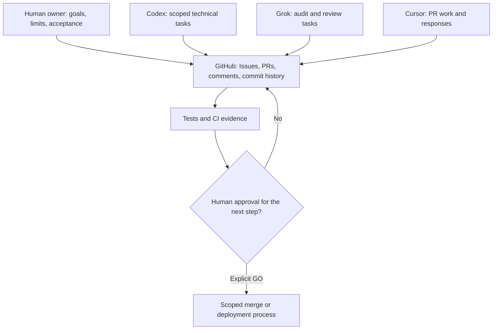
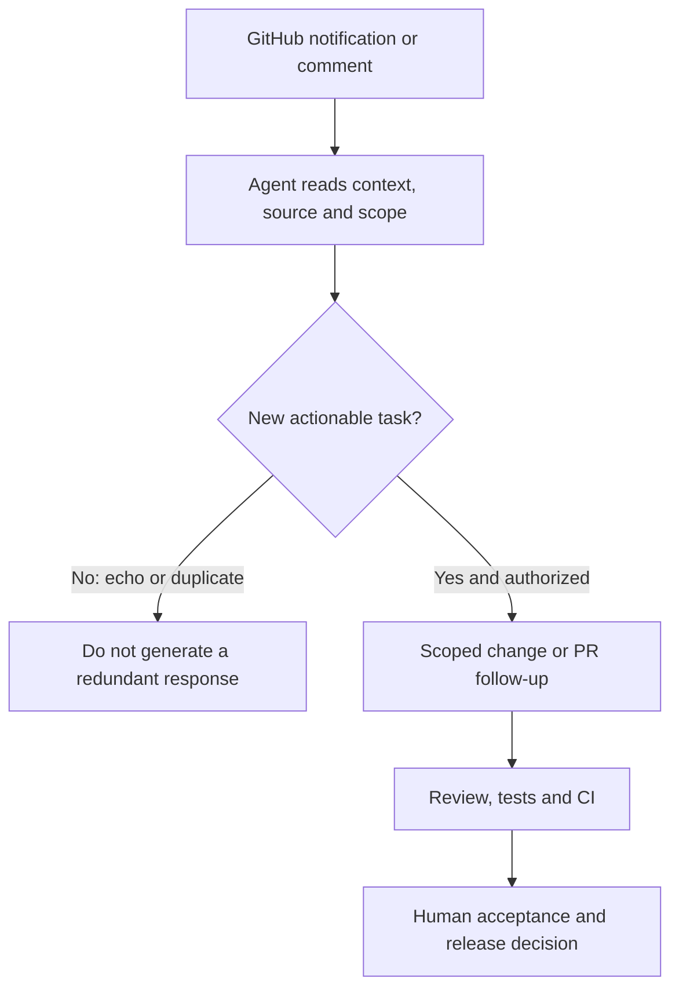

# Case: coordinating AI coding agents through GitHub

**Snapshot:** 29 October 2026 · **Scope:** owner-coordinated AI-assisted work in a private Django/SEO experiment.

[← Portfolio RU](../README.ru.md) · [All cases](../CASE_STUDIES.md) · [Agent operations](../AGENT_OPERATIONS.md)

## What this demonstrates

I use **GitHub Issues, pull requests, comments and CI as a shared asynchronous record** for work involving Codex, Grok and Cursor, under explicit human direction. The process helps maintain separate task scopes, inspect changes and avoid treating a bot's comment as a production release.

**This is not proof that the models directly communicate with each other, run continuously, or can safely make unrestricted release decisions.** Individual tool triggers and notification mechanics may differ.

## Observed private-project example

- During an SEO audit, a review identified a risk of **false-positive sitemap validation**: checking superficial URLs or shard counts was insufficient to prove a complete expected URL set.
- The agent-authored revision added **XML parsing and exact-inventory comparison**, with regression tests for missing, swapped and malformed entries.
- Owner review recorded **three successful CI workflows on one corrected commit**, while keeping the pull request **unmerged and undeployed** pending separate release approval.
- A related client-side URL-joining risk was **moved to a separate draft PR**, rather than silently expanding the first PR.
- In a supplied screenshot, an agent identified one notification as an echo of its own PR comment and chose not to act. This is **one observed response**, not evidence of a universal loop-prevention system.

**Owner's role:** priorities, agent task boundaries, review of evidence, escalation of gaps and release gates. AI tools authored significant implementation; this case does **not** claim self-written code, autonomous production release, search traffic or revenue.

**Evidence boundary:** source repository, PRs and exact CI logs are private. This public case deliberately omits private links, original screenshot, internal filenames, hosts and infrastructure. A sanitized demonstration can be prepared separately.

## Diagram 1 — coordination model

*The diagram depicts an operating pattern, not one permanently connected autonomous group chat.*

## Diagram 2 — notification handling example

*The echo/duplicate path reflects a specific screenshot, not a proven automatic filter for all events.*

## Value to an employer

This example is relevant to **AI Agent Operations, AI-assisted QA and development coordination**: I can distinguish a request from an event echo, keep workstreams within agreed scope, ask for precise tests, inspect one commit's CI and report what remains unverified. The strongest evidence of engineering quality comes from reproducible tests and separate human acceptance — not from claims that several models are «chatting».

Related quality-control practice: [independent builder/reviewer loop](INDEPENDENT_AGENT_REVIEW.md) · [по-русски](INDEPENDENT_AGENT_REVIEW.ru.md). This separate practice uses GitHub comments and does not imply autonomous cross-chat messaging.

[← Back to case index](../CASE_STUDIES.md) · [How I work with coding agents](../AGENT_OPERATIONS.md)
