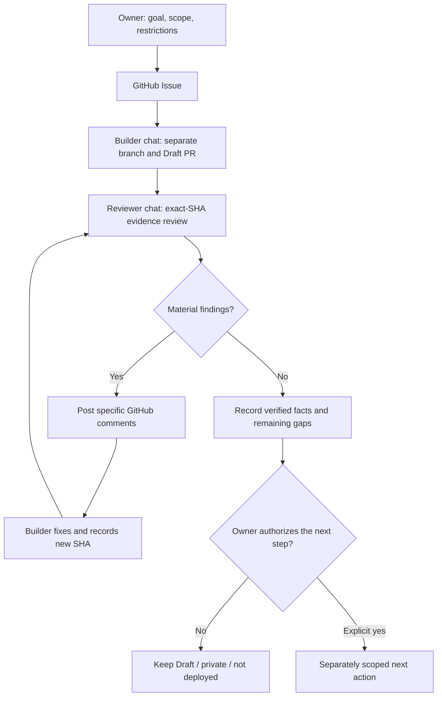

# Independent AI-agent review: writer → reviewer → correction → human gate

**Portfolio practice · 29 October 2026 · Human-coordinated, GitHub-mediated work**

[Русская версия](INDEPENDENT_AGENT_REVIEW.ru.md) · [Agent operations](../AGENT_OPERATIONS.md) · [Public evidence index](EVIDENCE_INDEX.md) · [Executable offline gate](../examples/pr-evidence-gate/README.md)

## The problem

An AI assistant can produce a persuasive completion report while relying on stale evidence, misinterpreting a test, or presenting a visual approximation as a verified result. Asking the same chat to approve its own output does not provide meaningful independent review.

## How I organize the handoff

1. **Owner** sets a limited objective, acceptance criteria, privacy restrictions and authority boundaries in a GitHub Issue.
2. **Builder chat** works in a dedicated branch and prepares a Draft PR, evidence ledger, tests/docs and known limitations.
3. **Separate reviewer chat** reads the *current* PR, examines the exact head SHA and source facts, and posts actionable comments in GitHub. It does **not** silently edit the builder's branch.
4. **Builder chat** reconciles objections against original evidence, commits changes and replies with a new head SHA.
5. **Reviewer** reads the revised files, distinguishes resolved findings from checks it still cannot perform, and records the outcome.
6. **Human owner** decides whether to accept a *document*, request more verification, merge code or release — these are separate decisions.

### Workflow diagram

*Two ChatGPT chats are separate working contexts coordinated by their owner through GitHub. This is **not** proof that they autonomously message each other, constitute independent models or are continuously running.*

## An observed review cycle (sanitized)

In one **private API-integration documentation project**, the builder prepared a **docs-only Draft PR** with an evidence matrix, a sanitized case description, two architecture diagrams and entirely fictional test fixtures. The reviewer noticed that the matrix relied on an **earlier stage of test results**, while the underlying branch documented later local checks. The builder corrected the chronology and distinguished **historical operator-reported tests** from checks independently repeated for the documentation review (**none**). The reviewer verified the updated SHA and accepted the factual correction.

In the same review cycle, another chat generated **Graphviz approximations** of two Mermaid diagrams and inspected the rough topology. That helped identify a very wide first diagram, but **did not verify GitHub's actual Mermaid rendering**. The visual QA gap remained open. The Draft PR was **not merged or published**.

**Evidence policy:** the source comments, PR and test matrix are in a private repository; no private links, original screenshots, pilot/account details, implementation, secrets or internal infrastructure are included here. This public narrative is a **sanitized process illustration**, not an independently reproducible integration demo.

## Reusable review checklist

| Gate | Ask the reviewer to establish | Do not infer |
| --- | --- | --- |
| Identity | Correct repository, PR, base, exact head SHA, changed paths | Old report applies to the latest commit |
| Evidence | Test name, run/source, environment, date and whether it was independently rerun | Test count means production readiness |
| Scope | No out-of-scope changes, credentials or private-data exposure | A docs-only PR automatically passes security |
| Visual QA | Actual target-renderer check; say when only a substitute renderer was viewed | Graphviz preview means GitHub Mermaid PASS |
| Handoff | Resolution of findings, new SHA, explicit residual risks | Agent says "done" means owner accepted |
| Release | Separate human permission for publication, merge or deployment | Draft approval permits public source release |

## What this demonstrates for an employer

The practical skill is **accountable AI-agent coordination**: keeping reviewer and author roles separate, grounding feedback in current sources, requiring a corrected SHA, recording genuine gaps and retaining a human release gate. Substantial code and documentation remain **AI-assisted**, not independently authored engineering.

**Status:** the review workflow and a private docs handoff were recorded; no public E2E API demo, visual GitHub Mermaid PASS or business-performance outcome is claimed.
