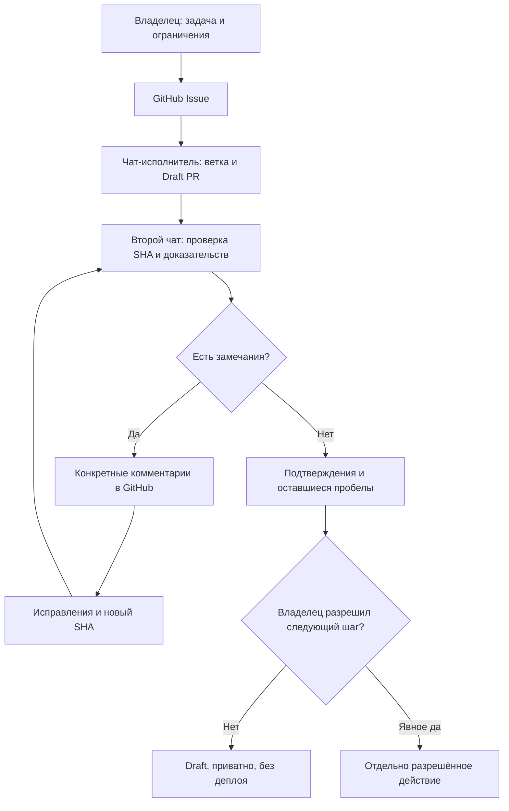

# Независимая проверка ИИ-агентов: исполнитель → ревьюер → исправление → решение человека

**Практика для портфолио · 29 октября 2026 · координация через GitHub**

[English version](INDEPENDENT_AGENT_REVIEW.md) · [Как работаю с агентами](../AGENT_OPERATIONS.md) · [Доказательства](EVIDENCE_INDEX.ru.md) · [Локальный PR/CI-инструмент](../examples/pr-evidence-gate/README.md)

## Почему это важно

ИИ может уверенно доложить о завершении задачи, опираясь на устаревшие результаты тестов или неподтверждённую визуальную проверку. Проверка результата **другим чатом** помогает обнаружить такие ошибки, но сама по себе не заменяет тесты, инженерное ревью и решение владельца.

## Как устроен рабочий процесс

1. **Владелец** фиксирует задачу в GitHub Issue: цель, ограничения, критерии готовности, приватность и полномочия.
2. **Чат-исполнитель** готовит материалы в отдельной ветке, оформляет Draft PR и отмечает неизвестное.
3. **Второй чат-ревьюер** независимо перечитывает текущий PR, точный SHA и исходные свидетельства. Замечания оставляет в GitHub, не переписывая рабочую ветку первого агента.
4. **Исполнитель** исправляет замечания, обновляет материалы и сообщает новый SHA.
5. **Ревьюер** повторно читает изменения и разделяет закрытые замечания и проверки, которые остались незавершёнными.
6. **Владелец** отдельно разрешает следующий шаг: принять документы, провести дополнительные тесты, слить PR или выпустить продукт.

### Схема рабочего процесса

*Здесь работают два отдельных контекста ChatGPT. Они взаимодействуют через GitHub под управлением человека. Это не доказательство самостоятельного беспрерывного общения агентов между собой.*

## Реальный пример без раскрытия проекта

Для **закрытого проекта с API-интеграцией** исполнитель подготовил Draft PR только с документацией: матрицу доказательств, обезличенный кейс, две схемы архитектуры и полностью вымышленные тестовые примеры.

Ревьюер обнаружил, что **в матрице использована ранняя стадия проверок**, хотя в актуальной ветке уже зафиксированы более поздние результаты. Исполнитель восстановил хронологию и отдельно указал, какие тесты были **ранее выполнены по отчётам**, а какие действительно повторены во время проверки документов (**ни одного**). Второй чат проверил изменения на новом SHA и принял исправления.

В следующем этапе были построены **приближённые схемы в Graphviz**. Они помогли увидеть, что первая схема слишком широкая, но **не заменили настоящий рендер Mermaid в GitHub**. Этот пункт честно остался незакрытым. PR не сливался и не публиковался.

**Приватность:** исходный PR, комментарии, технические доказательства и идентификаторы проекта остаются внутри закрытого репозитория. Здесь нет приватных ссылок, скриншотов, данных аккаунта, исходников или инфраструктуры. Это **описание процесса управления качеством**, а не публично воспроизводимое end-to-end API-демо.

## Чек-лист независимого ревью

| Что проверяем | Что нужно подтвердить | Чего нельзя предполагать |
| --- | --- | --- |
| Актуальность | Репозиторий, PR, база, точный SHA, изменённые файлы | Старый отчёт описывает новый коммит |
| Доказательства | Команды, дата, среда, источник тестов, кто повторил | Число PASS означает готовый production |
| Границы | Нет лишних правок, секретов, приватных данных | Docs-only автоматически безопасен |
| Схемы | Отрисовка именно в нужном интерфейсе | Graphviz равен GitHub Mermaid |
| Исправления | Замечания закрыты на новом SHA, пробелы записаны | Фраза «готово» означает приёмку |
| Выпуск | Чёткое разрешение владельца на конкретное действие | Draft разрешает публикацию исходников |

## Ценность для работодателя

Это подтверждает практику **AI Agent Operations / координации AI-assisted разработки**: распределение ответственности, независимое ревью, воспроизводимые замечания, проверку доказательств и сохранение человеческого контроля. Код и существенная часть документов созданы **с помощью агентов**, а не самостоятельно написаны владельцем.

**Текущий статус:** процесс и приватная проверка документов зафиксированы. Публичного end-to-end API-демо, подтверждённой визуальной проверки GitHub Mermaid и доказанного коммерческого результата пока нет.
