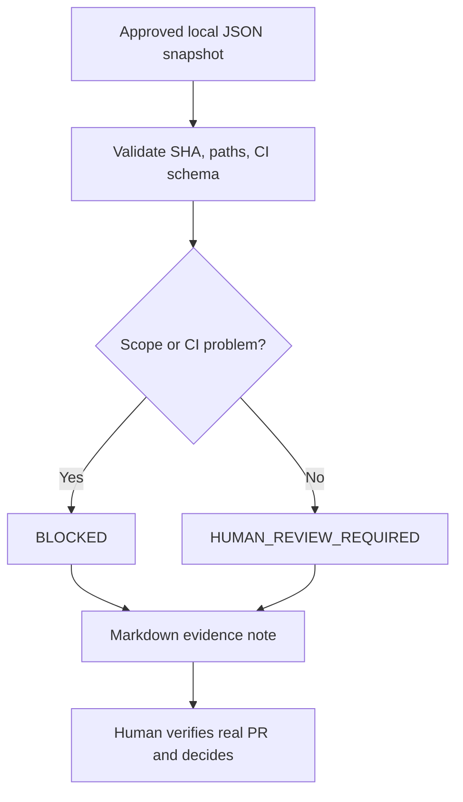

# Offline PR/CI evidence gate — executable portfolio demo

**Status: educational, synthetic, offline demonstration. Not a deployment tool or GitHub integration.**

This small Python 3.12 standard-library example demonstrates **human-in-the-loop AI-agent operations**. It reads a *manually prepared* JSON snapshot of a mock PR, checks what can be checked from those fields and prints a Markdown decision note.

**No tokens, internet, real repositories, proprietary source or API costs are involved.** There is no automated merge/deploy path.

## Why this is useful

AI agents can post comments, write code, launch tests and react to their own notifications. That does **not** automatically make their output safe to ship. A human coordinator needs a reproducible checklist for the exact commit, expected checks, agreed path scope and comment echoes.

This demo implements a deliberately **fail-closed** subset:
- Missing/invalid commit SHA, expected checks or changed-file inventory → reject input.
- Files outside the approved prefixes → `BLOCKED`.
- Failed, queued, skipped or cancelled expected CI job → `BLOCKED`.
- All listed checks successful and paths in scope → `HUMAN_REVIEW_REQUIRED`, **not** “safe to deploy”.
- A comment from the same actor is counted as a potential self-echo, not treated as a new work order.
- Comments from others are counted for **human** review. They are not parsed for instructions.

**Limits:** The JSON is user-provided; the script cannot prove that the snapshot is complete, that checks came from GitHub, that reviews or security scans happened, or that the source is safe. It does not detect all comment loops and must not be used as a real release gate. Never feed it sensitive client data.

## Run locally

```bash
python examples/pr-evidence-gate/triage.py --input examples/pr-evidence-gate/sample-approved.json
python examples/pr-evidence-gate/triage.py --input examples/pr-evidence-gate/sample-blocked.json
python -m unittest discover -s examples/pr-evidence-gate/tests -v
```

Optionally write a Markdown report:

```bash
python examples/pr-evidence-gate/triage.py --input examples/pr-evidence-gate/sample-approved.json --output report.md
```

The two input files are **invented fixtures**, not exports from a real private PR. The first example should produce `HUMAN_REVIEW_REQUIRED`; the second should produce `BLOCKED`.

## Illustration



## What this illustrates about the portfolio owner

The workflow and acceptance boundary come from operating AI-assisted GitHub projects: define roles and scopes, collect test evidence, prevent accidental scope expansion and keep **all release decisions with a human**. The Python implementation is an **AI-assisted demonstration**, not evidence of independently developed production automation.

[Evidence index EN](../../docs/EVIDENCE_INDEX.md) · [Доказательства RU](../../docs/EVIDENCE_INDEX.ru.md) · [AI-agent coordination case](../../docs/CASE_MULTI_AGENT_GITHUB.md)
